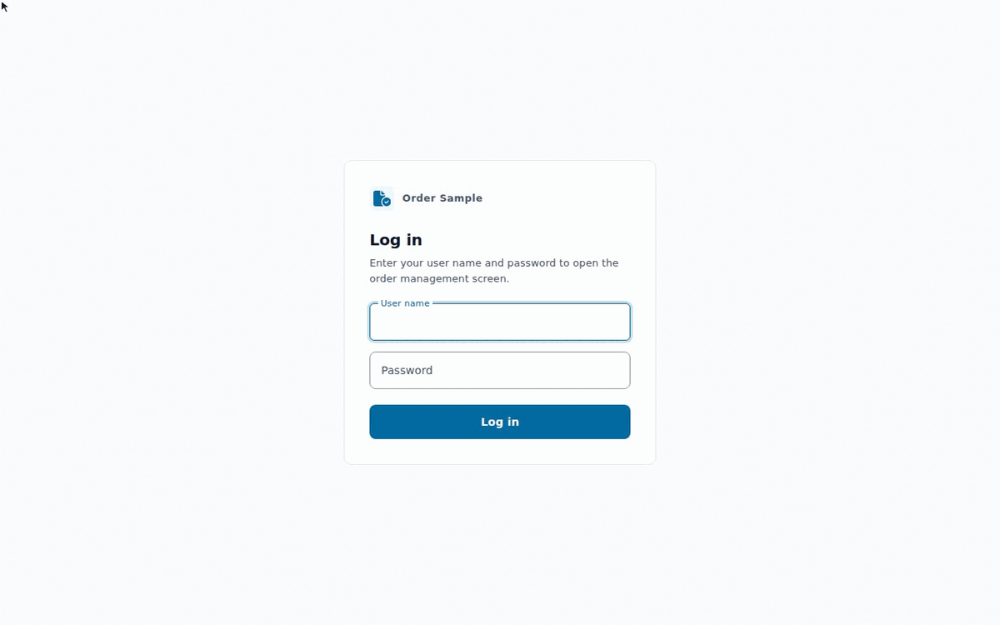

# jakarta-portable

[](https://github.com/yukkes/jakarta-portable/actions/workflows/build.yml)
[](https://github.com/yukkes/jakarta-portable/actions/workflows/matrix.yml)
[](LICENSE)
[](https://openjdk.org/)
[](https://jakarta.ee/specifications/)

[English](README.md) | **Japanese**

1 つの業務コードを書き換えずに **Quarkus、Open Liberty、WildFly、Payara Server、Payara Micro、GlassFish で動かす**リファレンス実装です。移植性を保ったまま Jakarta EE アプリを書くためのテンプレートとしても使えます。

Jakarta EE 10 の標準 API だけで、実用的な注文管理アプリ（REST API、Web UI、バッチ処理、認証認可）を構築しています。この API は Jakarta EE 11 でも動きます。



## ポイント

- **コードの複製なし**: 業務コードは `app/` の 1 か所だけです。EE サーバーには WAR として配備し、Quarkus は同じソースをコンパイルします。
- **ロックインをビルド時に防止**: `app/` にベンダー固有のライブラリが紛れ込むと、Maven Enforcer がビルドを失敗させます。
- **全実行基盤で同じテスト**: 共通の HTTP 適合テスト（`conformance/`）を各実行基盤に流します。
- **全実行基盤を同じ形で起動**: 各実行基盤は同じポート、環境変数、ヘルスチェックを持つコンテナです（`runtimes/README.md`）。

## Jakarta EE 10 と 11

コードは Jakarta EE 10 の API だけを使い、EE 11 も同じ API を提供するため、書き換えなしで両方で動きます。リポジトリは各ランタイムの最新リリース（EE 11）を組み立てます。EE 10 のリリースも、適合性テスト 32 件に合格します（2026-11-02）。

| ランタイム | EE 11: 最新リリース（既定） | EE 10: 合格する版 |
|---|---|---|
| Quarkus | 3.40.1.1 | 3.20.6 (LTS) |
| Open Liberty | 26.0.0.10 + `webProfile-11.0` | 26.0.0.10 + `webProfile-10.0` |
| WildFly | 42.0.0.Final | 39.0.1.Final |
| Payara Server、Payara Micro | 7.2026.10 | 6.2025.11 |
| GlassFish | 8.0.5 | 7.0.25 |

- **EE 10 のリリース**: 版を上書きして動かします（`make` のターゲットではありません）。[docs/runtimes.md](docs/runtimes.md) を参照してください。
- **対象外**: Quarkus 4 と、EE 11 だけの機能（Jakarta Data、`@Inject EntityManager`、CDI 4.1 の `Startup` イベント）。

### Open Liberty: Jakarta EE 8 から 11

1 つの Open Liberty リリースが、複数の Jakarta EE のバージョンに対応します。`server.xml` の機能で EE のバージョンを選びます。どの機能も、下の表の最初のリリースから最新のリリースまでのすべてに含まれるので、各リリースが提供する EE の範囲は次のとおりです。

| Open Liberty のリリース | 提供する Jakarta EE のバージョン |
|---|---|
| 26.0.0.5 以降 | 8、9.1、10、11 |
| 23.0.0.3 から 26.0.0.4 | 8、9.1、10 |
| 21.0.0.12 から 23.0.0.2 | 8、9.1 |
| 18.0.0.2 から 21.0.0.11 | 8 |

機能（Web Profile。Platform は `jakartaee-*`、EE 8 は `javaee-8.0` も）: `webProfile-8.0`、`webProfile-9.1`、`webProfile-10.0`、`webProfile-11.0`。リリース番号は、Maven Central にある機能の配布物（`io.openliberty.features:webProfile-10.0` など）によるものです。各バージョンの機能は、最初のリリースから最新まで、欠けなくすべてのリリースにあります。

- **このリポジトリ**: コードは `jakarta.*` パッケージを使うため EE 9.1 以降が必要で、EE 10 と 11 向けに書かれています。26.0.0.10 の `webProfile-11.0`（既定）と `webProfile-10.0`、および古い各メジャーバージョンの最新リリース（23.0.0.12、24.0.0.12、25.0.0.12）の `webProfile-10.0` で確認しました（各 32 件）。EE 8（`javax.*`）では動かせません。EE 9.1 は確認していません。
- **EE 11 は 26.x の最新を使う**: 最初の EE 11 リリースである 26.0.0.5 は EclipseLink 5.0.0 を同梱していて、開発用スキーマ（`make build-dev`、drop-and-create）を 1 つのトランザクションで実行します。空のデータベースでは最初の `DROP` が失敗し、PostgreSQL がトランザクションを中断して、後続の `CREATE TABLE` がすべて失敗し、アプリが起動しません。26.0.0.10 は EclipseLink 5.0.1 を同梱していて影響を受けません。スキーマ `none`（`make build`）も影響を受けません。26.0.0.6 から 26.0.0.9 は確認していません。
- **JDK**: 古い Liberty では、イメージの JDK も古くする必要があります（23 は `eclipse-temurin:17-jre`、24 は `21-jre`、25 以降は `25-jre`）。[docs/runtimes.md](docs/runtimes.md) を参照してください。

## クイックスタート

Java 21+、Maven 3.9+、Docker が必要です。

```bash
make build-dev       # ビルド（起動のたびにスキーマとサンプルデータを作り直す）
make up              # PostgreSQL と Quarkus（RUNTIME の既定値）を起動
make verify          # 適合テストを実行
make down            # コンテナを停止して削除
```

ブラウザで <http://localhost:8080/> を開き、`admin` / `admin` でログインできます。

### 別の実行基盤で動かす

```bash
make up RUNTIME=liberty        # wildfly、payara-micro、payara、glassfish も同様
make verify RUNTIME=liberty
make matrix                    # 全実行基盤を順に検証
```

## ディレクトリ構成

```text
jakarta-portable/
├── api/          OpenAPI 定義と生成 DTO
├── app/          業務コードと Web UI（唯一のソース）
├── runtimes/     実行基盤ごとのディレクトリ（Maven モジュール、Dockerfile、設定）
├── conformance/  全実行基盤が通すべき HTTP テスト
├── scripts/      scripts/portable（build、up、verify、matrix、bench）とベンチマーク
├── docs/         設計、移植性のメモ、計測結果
└── compose.yaml  PostgreSQL と実行基盤ごとの service
```

## さらに詳しく（英語ドキュメント）

| 知りたいこと | 参照先 |
|---|---|
| 開発手順、テスト、機能追加の方法 | [docs/development.md](docs/development.md) |
| 採用した Jakarta EE API と設計ルール | [docs/api-set.md](docs/api-set.md) |
| 各実行基盤が満たす取り決めと、追加の手順 | [runtimes/README.md](runtimes/README.md) |
| 実行基盤ごとの注意点 | [docs/runtimes.md](docs/runtimes.md) |
| JPA（JPQL）によるデータアクセス設計 | [docs/persistence.md](docs/persistence.md) |
| 起動時間、メモリ、スループット | [docs/performance.md](docs/performance.md) |

## ライセンス

[MIT](LICENSE)
