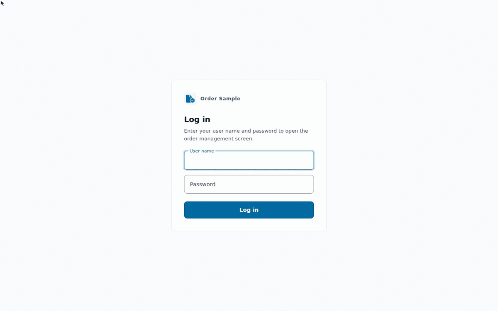

# jakarta-portable

[](https://github.com/yukkes/jakarta-portable/actions/workflows/build.yml)
[](https://github.com/yukkes/jakarta-portable/actions/workflows/matrix.yml)
[](LICENSE)
[](https://openjdk.org/)
[](https://jakarta.ee/specifications/)

**English** | [Japanese](README.ja.md)

One body of business code that runs **unchanged on Quarkus, Open Liberty, WildFly, Payara Server, Payara Micro and GlassFish**, and a template for writing Jakarta EE applications that stay that way.

It is a practical order management application (REST API, web UI, batch jobs, authentication and authorization) built only on the standard Jakarta EE 10 APIs, which also run on Jakarta EE 11.



## Highlights

- **No copied code**: All business code lives in `app/`. The EE servers deploy it as a WAR; Quarkus compiles the same sources.
- **No lock-in, enforced at build time**: Maven Enforcer fails the build when a vendor library sneaks into `app/`.
- **One test suite for every runtime**: The HTTP conformance suite (`conformance/`) runs against each runtime.
- **Every runtime the same way**: Each runtime is a container with the same port, environment and health check (`runtimes/README.md`).

## Jakarta EE 10 and 11

The code uses only Jakarta EE 10 APIs, which EE 11 also provides, so it runs unchanged on both. The repository builds the newest release of each runtime (EE 11); the EE 10 releases also pass the 32 conformance tests (2026-11-02).

| Runtime | EE 11: newest release (default) | EE 10: also passes |
|---|---|---|
| Quarkus | 3.40.1.1 | 3.20.6 (LTS) |
| Open Liberty | 26.0.0.10 + `webProfile-11.0` | 26.0.0.10 + `webProfile-10.0` |
| WildFly | 42.0.0.Final | 39.0.1.Final |
| Payara Server, Payara Micro | 7.2026.10 | 6.2025.11 |
| GlassFish | 8.0.5 | 7.0.25 |

- **EE 10 releases**: run them by overriding the version (not a `make` target); see [docs/runtimes.md](docs/runtimes.md).
- **Not covered**: Quarkus 4 and EE 11-only features (Jakarta Data, `@Inject EntityManager`, the CDI 4.1 `Startup` event).

### Open Liberty: Jakarta EE 8 to 11

One Open Liberty release serves several Jakarta EE versions; `server.xml` chooses the EE version with a feature. Each feature is in every release from the one below to the newest, so the range of EE versions a release offers is:

| Open Liberty release | Jakarta EE versions it offers |
|---|---|
| 26.0.0.5 and later | 8, 9.1, 10 and 11 |
| 23.0.0.3 to 26.0.0.4 | 8, 9.1 and 10 |
| 21.0.0.12 to 23.0.0.2 | 8 and 9.1 |
| 18.0.0.2 to 21.0.0.11 | 8 |

The features (Web Profile; the Platform is `jakartaee-*`, and `javaee-8.0` for EE 8): `webProfile-8.0`, `webProfile-9.1`, `webProfile-10.0`, `webProfile-11.0`. The release numbers are those of the feature artifacts on Maven Central (`io.openliberty.features:webProfile-10.0`, ...): each version has one for every release from its first, with no gaps, up to the newest.

- **This repository**: the code uses the `jakarta.*` packages, so it needs EE 9.1 or later, and it is written for EE 10 and 11. It is checked with `webProfile-11.0` on 26.0.0.10 (the default), with `webProfile-10.0` on 26.0.0.10, and with `webProfile-10.0` on the newest release of each older major version: 23.0.0.12, 24.0.0.12 and 25.0.0.12 (32 tests each). EE 8 (`javax.*`) cannot run it; EE 9.1 was not checked.
- **Use the newest 26.x for EE 11**: 26.0.0.5, the first EE 11 release, ships EclipseLink 5.0.0, which runs the dev schema (`make build-dev`, drop-and-create) in one transaction. On an empty database the first `DROP` fails, PostgreSQL aborts the transaction, every `CREATE TABLE` after it fails, and the application does not start. 26.0.0.10 ships EclipseLink 5.0.1 and is not affected, nor is the schema mode `none` (`make build`). 26.0.0.6 to 26.0.0.9 were not checked.
- **JDK**: older Liberty releases need an older JDK in the image (`eclipse-temurin:17-jre` for 23, `21-jre` for 24, `25-jre` from 25); see [docs/runtimes.md](docs/runtimes.md).

## Quick start

With Java 21+, Maven 3.9+ and Docker:

```bash
make build-dev       # build (the schema and sample data are recreated on every start)
make up              # start PostgreSQL and Quarkus (the default RUNTIME)
make verify          # run the conformance suite against it
make down            # stop and remove the containers
```

Open <http://localhost:8080/> and log in with `admin` / `admin`.

### Another runtime

```bash
make up RUNTIME=liberty        # also wildfly, payara-micro, payara, glassfish
make verify RUNTIME=liberty
make matrix                    # every runtime in turn
```

## Directory layout

```text
jakarta-portable/
├── api/          OpenAPI definition and generated DTOs
├── app/          business code and web UI (the single source)
├── runtimes/     one directory per runtime: Maven module, Dockerfile, config
├── conformance/  the HTTP suite every runtime must pass
├── scripts/      scripts/portable (build, up, verify, matrix, bench) and the benchmark
├── docs/         design, portability notes and measurements
└── compose.yaml  PostgreSQL and one service per runtime
```

## Learn more

| Topic | Document |
|---|---|
| Development workflow, testing and adding features | [docs/development.md](docs/development.md) |
| The Jakarta EE APIs used, and the design rules | [docs/api-set.md](docs/api-set.md) |
| What every runtime provides, and how to add one | [runtimes/README.md](runtimes/README.md) |
| Per-runtime notes and pitfalls | [docs/runtimes.md](docs/runtimes.md) |
| Data access with JPA (JPQL) | [docs/persistence.md](docs/persistence.md) |
| Startup time, memory and throughput | [docs/performance.md](docs/performance.md) |

## License

[MIT](LICENSE)
